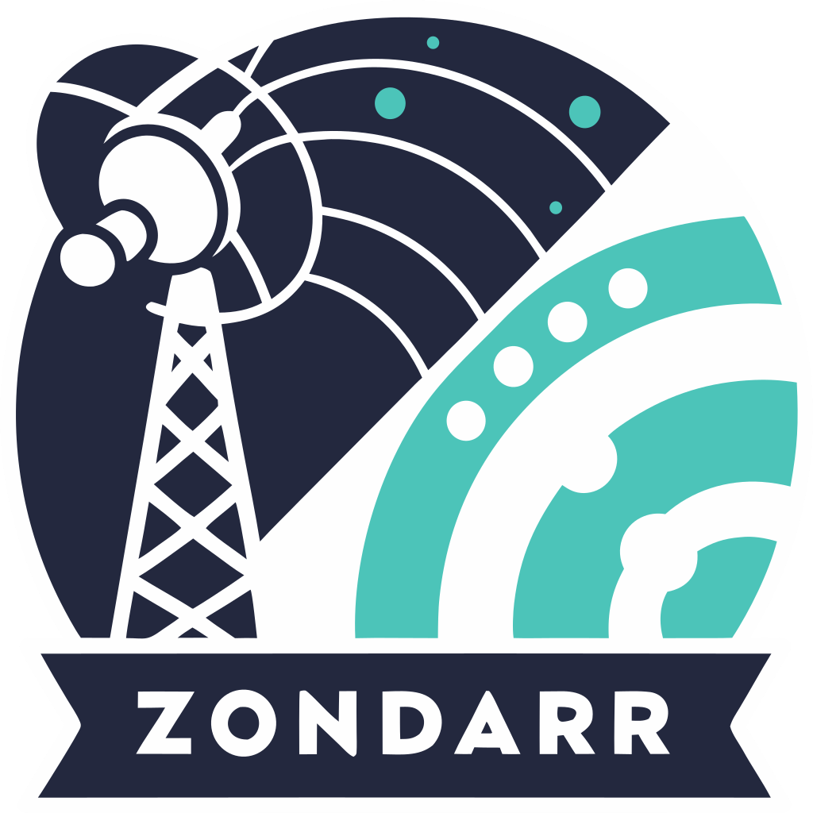

<p align="center">
  
</p>

<h1 align="center">zondarr</h1>

<p align="center">
  <strong>Unified invitations and user management for Plex and Jellyfin</strong>
</p>

<p align="center">
  <a href="https://github.com/edbfi/zondarr/blob/main/LICENSE"></a>
  <a href="https://github.com/oven-sh/bun" title="Bun source"></a>
  <a href="https://github.com/sveltejs/kit" title="SvelteKit source"></a>
  <a href="https://github.com/microsoft/TypeScript" title="TypeScript source"></a>
</p>

> [!IMPORTANT]
> **Rewrite in progress.** Zondarr is being rebuilt from scratch, and `main` is now the
> starting point for the new version. The previous version is preserved on the
> [`legacy-old/v1`](https://github.com/edbfi/zondarr/tree/legacy-old/v1) branch.

## Tech stack

| Concern | Choice |
| --- | --- |
| Language | TypeScript 6, strict type checking |
| Framework | Svelte 5 and SvelteKit 3, server rendering on one origin |
| Runtime and packages | Bun for development, CI and production |
| Database | Embedded Turso through Drizzle, on a persistent data volume |
| Styling and primitives | Panda CSS 2 and Ark UI for Svelte |
| HTTP API clients | `@hey-api/openapi-ts`, generated from the app's OpenAPI document |
| Plex | `@ctrl/plex`, with focused `fetch` methods for missing endpoints |
| Deployment | `@sveltejs/adapter-bun`: one container, one process, one HTTP port |

## Master key

Zondarr encrypts the secrets it stores with a master key you keep, and won't start without a
valid one. Which key you set depends on one question: has Zondarr run here before?

- **First install:** generate a key with `openssl rand -base64 32`, and keep a copy.
- **Existing install:** set the key it ran with, exactly as you saved it. Never generate a new key
  to get past a key error: Zondarr would start, but every secret it stored would be unreadable.

Set exactly one of these variables:

| Variable | Holds |
| --- | --- |
| `ZONDARR_SECRET_KEY` | the key itself |
| `ZONDARR_SECRET_KEY_FILE` | the path of a file holding the key, such as a Docker or Compose secret |

In the environment or a `.env` file:

```sh
ZONDARR_SECRET_KEY=paste-your-key-here
```

As a Compose secret, for a first install created with
`(umask 077; openssl rand -base64 32 > zondarr_key.txt)`:

```yaml
services:
  zondarr:
    environment:
      ZONDARR_SECRET_KEY_FILE: /run/secrets/zondarr_key
    secrets:
      - zondarr_key
secrets:
  zondarr_key:
    file: ./zondarr_key.txt
```

- A key is 44 characters ending in `=`, with no quotes or spaces around it. A key file may end in
  one newline.
- An empty variable counts as unset: `ZONDARR_SECRET_KEY=` is the same as leaving it out.

**If Zondarr won't start,** its error names the variable and what's wrong:
- *No key is set:* on an existing install, the variable went missing in an upgrade or a Compose
  change. Set your key again.
- *The key is refused:* on a first install, generate one as the error says. On an existing install,
  the key changed on its way in. Look for a stray space, a missing character or quotes kept around
  it, and set it exactly as you saved it.

**Changing the key:** Zondarr can't move stored secrets to a new key. After a change, each stored
secret fails with an error saying it was written under another master key. Enter it again, or set
the old key back, which still reads everything.

**Backups:** keep a copy of the key with your backups, apart from the database, and restore the
same key alongside them. Without it, stored secrets can't be read.

## Working on it

Start with [AGENTS.md](AGENTS.md): the house rules, the workflow and where each document lives.
The product and design context is in [PRODUCT.md](PRODUCT.md), [DESIGN.md](DESIGN.md) and
[docs/](docs/); the project spec is [docs/SPEC.md](docs/SPEC.md).
