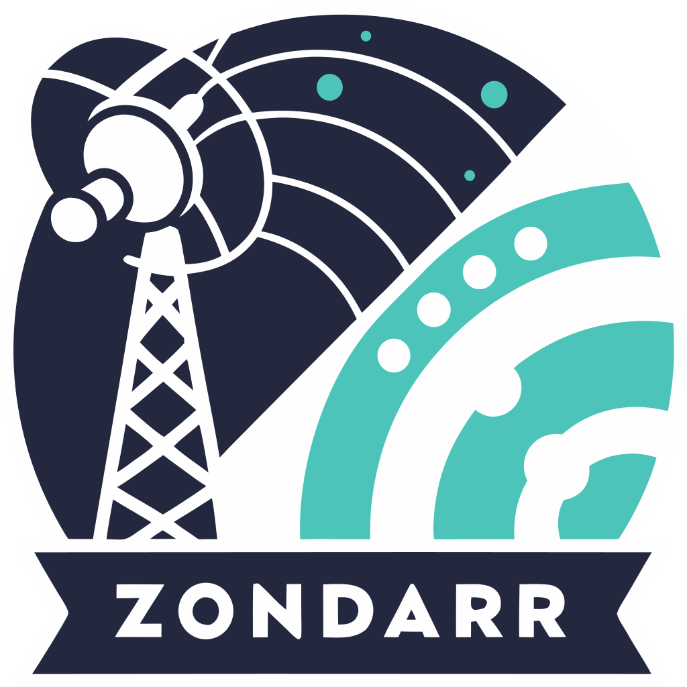

<p align="center">
  
</p>

<h1 align="center">zondarr</h1>

<p align="center">
  <strong>Unified invitations and user management for Plex and Jellyfin</strong>
</p>

<p align="center">
  <a href="https://github.com/edbfi/zondarr/blob/main/LICENSE"></a>
  <a href="https://github.com/oven-sh/bun" title="Bun source"></a>
  <a href="https://github.com/sveltejs/kit" title="SvelteKit source"></a>
  <a href="https://github.com/microsoft/TypeScript" title="TypeScript source"></a>
  <a href="https://github.com/edbfi/zondarr/actions/workflows/ci.yml?query=branch%3Amain"></a>
</p>

> [!IMPORTANT]
> **Rewrite in progress.** Zondarr is being rebuilt from scratch, and `main` is now the
> starting point for the new version. The previous version is preserved on the
> [`legacy-old/v1`](https://github.com/edbfi/zondarr/tree/legacy-old/v1) branch.

## Tech stack

| Concern | Choice |
| --- | --- |
| Language | TypeScript 6, strict type checking |
| Framework | Svelte 5 and SvelteKit 3, server rendering on one origin |
| Runtime and packages | Bun for development, CI and production |
| Database | Embedded Turso through Drizzle, on a persistent data volume |
| Styling and primitives | Panda CSS 2 and Ark UI for Svelte |
| HTTP API clients | `@hey-api/openapi-ts`, generated from the app's OpenAPI document |
| Plex | `@ctrl/plex`, with focused `fetch` methods for missing endpoints |
| Deployment | `@sveltejs/adapter-bun`: one container, one process, one HTTP port |

## Master key

Zondarr encrypts the secrets it stores with a master key you keep, and won't start without a
valid one. Which key you set depends on one question: has Zondarr run here before?

- **First install:** generate a key with `openssl rand -base64 32`, and keep a copy.
- **Existing install:** set the key it ran with, exactly as you saved it. Never generate a new key
  to get past a key error: Zondarr would start, but every secret it stored would be unreadable.

Set exactly one of these variables:

| Variable | Holds |
| --- | --- |
| `ZONDARR_SECRET_KEY` | the key itself |
| `ZONDARR_SECRET_KEY_FILE` | the path of a file holding the key, such as a Docker or Compose secret |

In the environment or a `.env` file:

```sh
ZONDARR_SECRET_KEY=paste-your-key-here
```

As a Compose secret, for a first install created with
`(umask 077; openssl rand -base64 32 > zondarr_key.txt)`:

```yaml
services:
  zondarr:
    environment:
      ZONDARR_SECRET_KEY_FILE: /run/secrets/zondarr_key
    secrets:
      - zondarr_key
secrets:
  zondarr_key:
    file: ./zondarr_key.txt
```

- A key is 44 characters ending in `=`, with no quotes or spaces around it. A key file may end in
  one newline.
- An empty variable counts as unset: `ZONDARR_SECRET_KEY=` is the same as leaving it out.

**If Zondarr won't start,** its error names the variable and what's wrong:
- *No key is set:* on an existing install, the variable went missing in an upgrade or a Compose
  change. Set your key again.
- *The key is refused:* on a first install, generate one as the error says. On an existing install,
  the key changed on its way in. Look for a stray space, a missing character or quotes kept around
  it, and set it exactly as you saved it.

**Changing the key:** Zondarr can't move stored secrets to a new key. After a change, each stored
secret fails with an error saying it was written under another master key. Enter it again, or set
the old key back, which still reads everything.

**Backups:** keep a copy of the key with your backups, apart from the database, and restore the
same key alongside them. Without it, stored secrets can't be read.

## Database

Zondarr keeps everything it stores in one database file: `data/zondarr.db` in its working
directory, or the path `ZONDARR_DATABASE_PATH` names. Zondarr creates the file's folder if it is
missing, and won't start if it can't create or write to it, or can't open the file as a database.
Put the folder on a persistent volume.

**Backups:** stop Zondarr, then copy the whole folder. Recent writes live in files beside the
database (`zondarr.db-wal`), so a copy of the database file alone can miss them, and a copy taken
while Zondarr runs can be incomplete. Back up the master key separately
([Master key](#master-key)), and keep its file outside this folder.

| Variable | Holds | Default |
| --- | --- | --- |
| `ZONDARR_DATABASE_PATH` | the database file's path, absolute or against the working directory | `data/zondarr.db` |

**Running the build yourself:** `bun ./build` needs one package beside `build/`, Turso's native
binding for your platform, as `bun ci` installs it:
`node_modules/@tursodatabase/database-linux-x64-gnu` (or `-linux-arm64-gnu`). Start the server with
`bun --no-install ./build`, so a missing package stops it instead of being downloaded.

## The address browsers use

`ORIGIN` is optional. It tells Zondarr the address browsers use, as a bare origin with no path:

| Variable | Holds | Default |
| --- | --- | --- |
| `ORIGIN` | the address browsers use, such as `https://zondarr.example` or `http://192.168.1.20:3000` | unset |

Zondarr won't start if `ORIGIN` is empty or holds a path, a query, a fragment or credentials;
leave it out instead. When `ORIGIN` is `https`, or, without it, when the browser reaches Zondarr
over HTTPS, pages ask browsers to keep using HTTPS. `ORIGIN` is set only here, in the environment: there is no setting
for it in the console, and it isn't the public invite address.

## Logs

Zondarr writes its log to standard output, one JSON entry per line, where your container runtime
collects it. Credentials are removed before an entry is written: passwords, tokens, cookies and
keys, and the credentials in URLs. An unexpected error is logged the same way, and the browser only
ever sees "Internal Error".

| Variable | Holds | Default |
| --- | --- | --- |
| `ZONDARR_LOG_DEBUG` | `true` to add debug entries, or `false` | `false` |

## Health

Three public addresses answer in JSON, never cached and never with a version:

| Path | Answers |
| --- | --- |
| `/healthz` | `healthy` with 200, or `degraded` with 503 when the database doesn't answer |
| `/healthz/live` | `alive` with 200 while Zondarr serves requests |
| `/healthz/ready` | `ready` with 200, or `not ready` with 503 when the database doesn't answer |

Point a container's health check at `/healthz/live`, so a database fault shows as degraded instead
of restarting Zondarr over and over; watch `/healthz` from your monitoring.

## Stopping and the server's limits

Zondarr stops cleanly on `SIGTERM`, `SIGINT` or `SIGHUP`: it lets the requests in progress finish,
for up to `SHUTDOWN_TIMEOUT` seconds, closes the database, and exits. These variables belong to the
Bun server it runs on:

| Variable | Holds | Default |
| --- | --- | --- |
| `SHUTDOWN_TIMEOUT` | seconds to let requests finish when stopping | `30` |
| `CONNECTION_IDLE_TIMEOUT` | seconds before an idle connection closes, at most 255 | `10` |
| `BODY_SIZE_LIMIT` | the largest request body accepted | `512K` |

After the requests finish, Zondarr takes about 5 more seconds at most to close. Give the container
longer than `SHUTDOWN_TIMEOUT` plus 5 seconds to stop, or it's killed mid-write. Docker's default is
10 seconds, so with the default `SHUTDOWN_TIMEOUT`, set Compose's `stop_grace_period` to `40s`.

## Working on it

Start with [AGENTS.md](AGENTS.md): the house rules, the workflow and where each document lives.
The product and design context is in [PRODUCT.md](PRODUCT.md), [DESIGN.md](DESIGN.md) and
[docs/](docs/); the project spec is [docs/SPEC.md](docs/SPEC.md).

## License

Zondarr's original code is licensed under the GNU Affero General Public License as published by
the Free Software Foundation, either version 3 of the License, or (at your option) any later
version (`AGPL-3.0-or-later`). See [LICENSE](LICENSE) for the full terms.

Third-party code, dependencies and vendored agent skills retain their respective licenses and
copyright notices. This grant does not replace their terms or revoke earlier grants.
